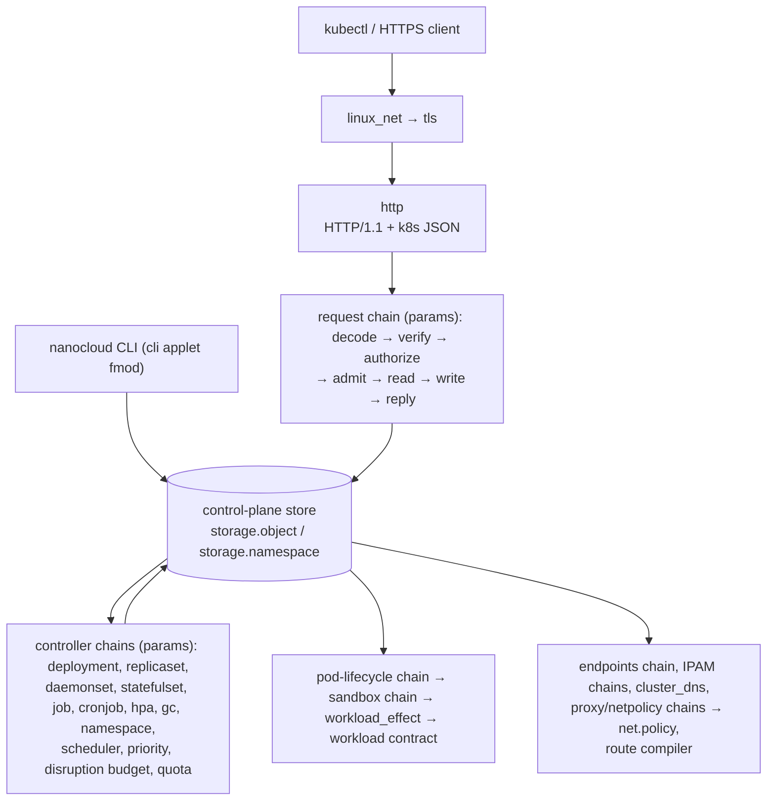

# Nanocloud

Nanocloud is a Kubernetes control plane that runs as a [fluxor](../fluxor/)
graph. The apiserver, every controller and the node's own lifecycle are chains
of generic engines carrying compiled rules. The `no_std` position-independent
modules (`.fmod`) in the tree hold almost no Kubernetes meaning: nearly every
one is a connector, moving bytes across one seam — the store, a socket, an
HTTP route, a container, the packet filter, a volume. The exceptions are the
CLI and `node_pki`, which writes the Kubernetes objects of a node's join (its
Devices and the slot's ServiceAccount). There is no host binary and
no separate database: install the package, start one systemd unit, and the
node serves the Kubernetes API.

## Highlights

- **The control plane is a graph.** `fluxor run controlplane.yaml` starts the
  apiserver, the verify → authorize → admit → CRUD request path, and every
  workload controller in a single runtime. Composition is a YAML graph, not a
  process tree.
- **The logic is rules, not code.** A Deployment becoming a ReplicaSet, an
  ownerRef cascade, a scheduler's placement, what `/api/v1` means and what a
  refusal answers: each is a chain of generic Chronicle engines carrying params
  compiled from `modules/app/_chronicle/*.uproc`. No `.fmod` holds what a
  Deployment is, or what a Kubernetes path names.
- **Kubernetes-shaped API.** `kubectl` talks to it directly: discovery for
  `core/v1`, `apps/v1`, `batch/v1`, `rbac.authorization.k8s.io/v1`,
  `scheduling.k8s.io/v1`, `policy/v1`, `networking.k8s.io/v1` and
  `nanocloud.io/v1`, list/get/create/update/delete, `?watch=true` watches
  fenced on the store's own revisions, and `kubectl create`'s typed
  generators, which send protobuf.
- **One store, replicated.** Control-plane state lives in fluxor's
  `storage.object` / `storage.namespace` contracts — versioned keyed bytes with
  compare-and-swap, prefix listing and change subscriptions — served by
  lattice's store as one replica of a group: every write is decided through
  clustor's log (the control-plane nodes are its voters, each worker a
  learner, every peer link mutually authenticated). Each node's graph is its
  replica's only writer, so a watch is a projection of the store's revision stream rather
  than a poll.
- **Host facts stay behind capability surfaces.** A module never calls libc.
  Sockets arrive through `linux_net`/`tls`, containers through the `workload`
  contract, files through `fs`, private keys through the kernel key vault — each
  one a contract admission can gate.
- **Decision and effect are separate.** Controllers compute; the node's backends
  act. Service proxying and NetworkPolicy are rows in the store, applied as a
  `net.policy` table the platform realizes — nftables on Linux, the packet
  filter on bare metal — and whether it is enforced is written down, never
  assumed; the pod-lifecycle chain projects the sandboxes a node should be
  running, and `workload_effect` performs them.
- **Behaviour is proven on real binaries.** There are no unit tests to mock the
  seams: `make test` boots the built `.fmod` artefacts in a fluxor runtime and
  drives them over real HTTP, the real store, and real mTLS.

## Architecture



Every arrow into or out of the store is a contract call, and no stage addresses
another directly — the only direct channels are the net streams at the edge, the
records a chain hands along, and each module's own change sink. A request is
admitted at the edge, written once, and every controller that cares wakes on
the change and writes its own outputs back.
[docs/architecture/modules.md](docs/architecture/modules.md) describes each
chain, the keys it owns, the connectors it reaches them through, and the
capability surfaces behind them.

## Install

The package is built from this checkout against a sibling fluxor tree:

```bash
fluxor update && fluxor sync            # resolve + materialise deps and the SDK
make build                              # build modules/app/* for bcm2712
packaging/debian/build.sh               # stage the .deb
tools/install_deb.sh                    # dpkg -i the newest build, restart the unit
```

The package installs the fluxor CLI and runtime, every nanocloud `.fmod`, the
control-plane and worker graph templates (`/etc/nanocloud.io/fluxor/`) with
the fragments they are rendered from (the store's replica, the kubelet, the
image pull), and a systemd unit that renders this node's graph
(`nanocloud-graph.sh`, from `/etc/nanocloud.io/cluster.env` and the peer keys
in `/etc/nanocloud.io/pki`, both provisioned on install) and runs it in
`/var/lib/nanocloud.io/control-plane/store`. A fresh install is a cluster of
one: the control plane, replica 0, alone, and its own node — its cluster.env
says `NANOCLOUD_PODS=1`, so it registers itself in `/nodes/`, keeps its lease
and runs the Pods scheduled onto it.

A bare image reference means the node's registry: `NANOCLOUD_REGISTRY`
(default `registry.nanocloud.io:5000`), dialled at `NANOCLOUD_REGISTRY_ADDR`,
over TLS authenticated by the CA at `NANOCLOUD_REGISTRY_CA` (DER, default
`/etc/nanocloud.io/certs/ca.der`; without it the node pulls nothing and says
so when its graph renders). A reference naming another registry is pulled
from that registry, dialled by its own name — over TLS it must be one the
node's `tls` client trusts and may name (the default render pins the node
registry's CA and name, so another registry's handshake fails: an
`ErrImagePull` saying it could not be reached). A tag is resolved to its
manifest digest and everything pulled is keyed by the digest; the Pod runs
the digest it resolved. An image index (a multi-arch tag) is read for the
node's own platform — linux and its `kubernetes.io/arch` label (arm64 takes
a `v8` variant or none) — and an index with nothing for it is the Pod's
`ErrImagePull` ("no matching manifest for linux/arm64/v8 in the manifest
list entries"), retried with the backoff. `imagePullPolicy` is honoured with
upstream's defaults (`Always` for `:latest` or no tag: the tag is asked again
for each Pod; `IfNotPresent` otherwise; `Never`: only what is cached).

Credentials: a registry that asks for them (a Bearer token from its realm,
or Basic) is offered, in turn until one serves, the Pod's
`imagePullSecrets` — or, when it states none, its ServiceAccount's —
(`kubernetes.io/dockerconfigjson` or `kubernetes.io/dockercfg` Secrets, each
one's entry for the registry), then the node's own at the store key
`/registry-auth/<registry host>` (`user:password`), then none. As upstream's
kubelet does by default (its `ensureImagePullCredentials` is alpha and off),
an image already on the node is not authorized again: an `IfNotPresent` Pod
runs it whatever credentials it brings, and a pull Pods share is asked with
the credentials of every Pod waiting on it. A Pod that must be refused what
it cannot pull itself states `imagePullPolicy: Always`: its pull is its own,
with its own credentials, and a 401 is its `ErrImagePull`.

A failed rootfs assembly is retried with the pull's backoff (10 s doubling
to 300 s) and said on the Pod (`ErrImagePull`, then `ImagePullBackOff`); a
cached layer found missing or not its digest is fetched again. Images are
garbage-collected as a kubelet does: past `gc_high` images held (in the
store record `/config/image`; default 20) the least recently used ones no
Pod uses are removed — records, rootfs directory and the blobs no other
image holds — down to `gc_low` (15), none unused for less than `gc_min` ms
(120000), and with `gc_max` set any unused that long; never one in use or
being pulled. Disk thresholds are not offered: the fs contract states no
free space.
`/usr/bin/nanocloud` is a busybox-style symlink to `fluxor`, so `nanocloud <cmd>`
dispatches the `nanocloud_cli` applet.

## A cluster

A worker joins the control plane's store as a learner. On the worker, set
`NANOCLOUD_ROLE=node`, its `NANOCLOUD_REPLICA_ID` and `NANOCLOUD_PEERS`
(every replica's address) in `/etc/nanocloud.io/cluster.env`, and give it
each replica's certificate as `/etc/nanocloud.io/pki/peers/<id>.pem`; give
every control-plane node the worker's (`nanocloud-cluster pin` prints a
node's). Then, on a control-plane node:

```bash
sudo nanocloud-cluster add-node 1       # replica 1 joins, by the operator key
```

The worker registers itself in `/nodes/`, renews its lease, and is scheduled
onto once ready.

### Under the cluster's own authority

With `NANOCLOUD_PEER_TRUST=authority` in `cluster.env` no key is provisioned
at all: every TLS key (the API's, each peer link end's) is born in the node's
vault and certified by the control plane's own authority (kagi's
`certificate_endpoint`, under the vault key `nanocloud.ca`). The bare-metal
control plane runs this way (`scripts/rig-render-controlplane.sh`).

The control plane announces a single-use join secret beside its authority's
key digest; the operator trades it for a kubeconfig and, for each worker slot
(every replica in `NANOCLOUD_PEERS` past the voters), that slot's bootstrap
credential:

```bash
# from the node's log: [join] secret=<hex> ca-sha256=<hex>
scripts/rig-join.sh <secret> <ca-sha256> <host:port> <dir>/kubeconfig
# -> <dir>/kubeconfig, <dir>/ca.der, <dir>/node-<id>.token
```

A slot's credential may patch and read that slot's two Devices
(`nanocloud-peers/replica-<id>.server`, `.client`) and nothing else. On the
worker, put `ca.der` and `node-<id>.token` in `/etc/nanocloud.io/pki` as
`plane-ca.der` and `node.token`, and set `NANOCLOUD_ROLE=node`,
`NANOCLOUD_PEER_TRUST=authority` and `NANOCLOUD_PLANE_API=<host:port>`: its
link ends' keys are certified through the API (the Device names the key, the
control plane's device chain certifies it, the worker reads the certificate
back), and the control plane adds it as a learner once its principal binds —
no `add-node`. `scripts/node-join-e2e.sh` runs the whole of it on one host;
`NC_PLANE=<ip>` runs its worker half against a board.

The CLI applet is this node's replica run offline (the service stopped).
Under authority it carries the node's authority itself — the same vault key
certifies the same principals — so give it the service's vault, as root:

```bash
sudo sh -c '. /etc/nanocloud.io/seal.env; export FLUXOR_SEAL_KEY \
  FLUXOR_VAULT_DIR=/var/lib/nanocloud.io/control-plane/store/vault; \
  cd /var/lib/nanocloud.io/control-plane/store && nanocloud get namespaces'
```

Without the seal key its keys are its own and unsealed for the run: fine
for a single-voter plane, refused by the peers of a larger one.

## Using it

```bash
sudo systemctl start nanocloud          # run the control-plane graph

nanocloud status                        # cluster object counts
nanocloud get pods                      # list object names under a resource
nanocloud get pods default/web-0        # show one object's stored fields
nanocloud describe pods default/web-0   # a labelled read of one object
nanocloud apply deployments default/web '{"spec":{"replicas":3, ...}}'
nanocloud scale deployments default/web 5
nanocloud delete pods default/web-0
nanocloud rollout status default/web    # progress against the current template
nanocloud rollout undo default/web      # restore the archived previous template
nanocloud watch pods                    # stream a listing as it changes
nanocloud logs -f <sandbox>             # a sandbox's stdout/stderr
nanocloud exec -it <sandbox> -- sh      # a command inside a sandbox
nanocloud diagnostics                   # counts across every resource + health
nanocloud policy                        # NetworkPolicies + enforcement status
nanocloud volume                        # PVCs and the volumes bound to them
nanocloud bundle export > cluster.txt   # every object as `<key>\t<json>` lines
nanocloud bundle apply < cluster.txt    # recreate them from that dump
nanocloud token default-sa default      # mint a ServiceAccount JWT
nanocloud ca                            # print the cluster CA certificate
```

The CLI drives the store directly through the storage contracts, so it works
without the HTTP edge. `kubectl` reaches the same objects over the API, served
on :7443:

```bash
kubectl --server https://127.0.0.1:7443 get pods -A --watch
```

## The API surface

| Group | Resources |
| ----- | --------- |
| core/v1 | pods (+ `pods/log`, `pods/status`, `pods/eviction`), services, endpoints, configmaps, secrets, serviceaccounts (+ `serviceaccounts/token`), events, persistentvolumeclaims, persistentvolumes, namespaces, nodes, resourcequotas |
| apps/v1 | deployments, replicasets, statefulsets, daemonsets |
| batch/v1 | jobs, cronjobs |
| rbac.authorization.k8s.io/v1 | roles, clusterroles, rolebindings, clusterrolebindings |
| scheduling.k8s.io/v1 | priorityclasses |
| policy/v1 | poddisruptionbudgets |
| networking.k8s.io/v1 | ingresses, ingressclasses, networkpolicies |
| nanocloud.io/v1 | graphs, devices |

Those are what the discovery documents advertise. Path resolution is generic —
the rules read a path's *shape*, not a list of kinds — so an object of any
other kind is addressable at the same path shapes and keyed group-qualified.

The request path is a Chronicle chain: wave's `http` terminates HTTP/1.1 behind
`tls` and hands each request, as an exchange, to `http_chain`, which gives the
chain one request envelope for it and turns the chain's replies into its
response; a Chronicle decode program (`kube.rd`) projects the envelope into a
record, and every decision after that — which resource a path names, whether the credential is good enough,
what a refusal answers, which store operation the verb implies — is params
compiled from `modules/app/_chronicle/apiplane.uproc`. Authorization is one
store probe of a grant index that the RBAC chains keep true from the real
Role/ClusterRole/RoleBinding/ClusterRoleBinding objects. Admission is params
too: a policy read and a live-object COUNT through `store_effect`, then a
decision. No node on the path holds Kubernetes meaning in compiled code.

Discovery documents (`/api`, `/apis`, `/api/v1`, `/apis/<group>/<version>`),
`/version` and `/openapi/v3` are literals in decisions — the API surface is
data (`apiplane_admit.uproc`: `admit` answers discovery, and `oapi`, the node
after it, the OpenAPI documents, because together they pass the 16 KiB one
compiled decision holds).

A body sent as `application/vnd.kubernetes.protobuf` — what `kubectl create
configmap|secret|deployment|job|role|…` sends, with no JSON fallback — is
transcoded to the JSON object it stands for at the ingress (`http_chain`,
`_shared/k8s_proto.rs`), against a schema generated from Kubernetes'
`generated.proto` and Go types (`scripts/support/k8s_proto_schema.py`); the
chain never sees protobuf. `kubectl create token` (a TokenRequest on
`serviceaccounts/<name>/token`) is signed by the plane's one issuer — the same
`token_mint` and vault key the store-driven tokens use — and answered with the
token and its `expirationTimestamp` (`apiplane_token.uproc`).
Namespaced paths (`/apis/<group>/<v>/namespaces/<ns>/<resource>[/<name>]`) and
cluster-scoped paths resolve through the same rules; a grouped resource is keyed
group-qualified (`deployments.apps`) so it never collides with a same-named
resource in another group. `?watch=true` is served by a second chain driven by
store changes, writing into the same reply stage.

### Kubernetes compatibility: what a container becomes

Every container of a Pod — its `initContainers` and its `containers` — runs as
a process of its own, sharing the Pod's network (its node's, unless the Pod
has an address of its own) and its volumes (a Pod without an image runs its
command on the node, a Pod with `runtimeClassName: fluxor` as a module
subgraph). The control plane resolves each container once it is scheduled
(`pod_resolve`, `_shared/podres.rs`), as the kubelet does. What is honoured,
and what is not yet:

- **Image**: pulled (the node's platform out of a multi-arch index;
  `imagePullSecrets`, the ServiceAccount's, `imagePullPolicy`), its rootfs
  the process's root (an isolated sandbox: the node runs as root). Pending
  until pulled; a failed pull or assembly is retried with a backoff and said
  on the Pod. Unused images are garbage-collected.
- **command / args** against the image's Entrypoint / Cmd, by the Kubernetes
  rules (both; command only; args only; neither), each `$(VAR)` expanded
  against the container's environment (`$$` a literal `$`, an unknown name
  left as written).
- **env**: exactly `HOSTNAME` (the Pod's name), the image's `Env`, then the
  namespace's Service links (`<SVC>_SERVICE_HOST`, `_SERVICE_PORT`,
  `_SERVICE_PORT_<NAME>`, `<SVC>_PORT`, `_PORT_<p>_<PROTO>[_PROTO|_PORT|_ADDR]`;
  the default namespace's `kubernetes` always, the rest unless
  `enableServiceLinks: false`), `envFrom` (a ConfigMap, a Secret, `prefix`),
  then `env` in order — `value` with `$(VAR)` expanded, or `valueFrom`
  `configMapKeyRef`, `secretKeyRef`, `fieldRef` (`metadata.name`,
  `.namespace`, `.uid`, `.labels['…']`, `.annotations['…']`,
  `spec.nodeName`, `spec.serviceAccountName`, `status.podIP`, `status.hostIP`)
  and `resourceFieldRef` (limits or requests, `divisor`, a limit not set read
  as the node's allocatable) — a later definition overriding an earlier,
  `HOME` from the image's passwd, `PATH` defaulted when nothing sets it;
  nothing of the node's own environment. A ConfigMap or Secret that is
  missing (and not `optional`) holds the container in
  CreateContainerConfigError until it exists.
- **workingDir**, else the image's `WorkingDir` (created), else `/`.
- **User**: `securityContext.runAsUser` / `runAsGroup` (the container's over
  the Pod's; a `runAsGroup` alone keeps the image's uid), else the image's
  `User` (`uid[:gid]`, or a name in the image's own `/etc/passwd` and
  `/etc/group`). `runAsNonRoot` refuses a root user, and an image user given
  as a name it cannot verify (CreateContainerConfigError). The Pod's
  `fsGroup` and `supplementalGroups` are the process's supplementary groups,
  with the image's `/etc/group` memberships (`supplementalGroupsPolicy`
  Merge, the default) or without them (Strict); `readOnlyRootFilesystem`
  makes the container's root read-only, its volumes keeping their own access.
- **Volumes** (`volumes` + `volumeMounts`, `readOnly`): a
  PersistentVolumeClaim (an encrypted Loam volume once attached and mounted on
  the node, or a statically provisioned `hostPath`/`local` PersistentVolume
  bound to it by `claimRef` or `volumeName`); an `emptyDir` (the Pod's own
  directory on its node, kept across its containers' restarts, removed with
  the Pod); a `configMap` or `secret` (each key a file, or `items` at their
  paths, `defaultMode`/`mode`, `optional`, read-only; written as upstream's
  AtomicWriter writes them, so an update to the object reaches a running
  container whole; a Secret's files on a memory filesystem); a `downwardAPI`
  volume (`fieldRef`, the labels and annotations maps, `resourceFieldRef`)
  and a `projected` one (ConfigMap, Secret and downward-API sources, on a
  memory filesystem); a `hostPath` (refused
  under the namespace's Pod Security level `baseline` or `restricted`). With
  the Pod's `fsGroup` an emptyDir, a claim it may write (under the node's
  mount root) and the projected files are group-owned by it
  (`fsGroupChangePolicy` Always or OnRootMismatch). A
  StatefulSet's `volumeClaimTemplates` give each ordinal its own claim,
  `<template>-<pod>`, created once and kept across the Pod's recreations.
- **DNS**: `/etc/resolv.conf` by `dnsPolicy` (ClusterFirst: the cluster DNS,
  the namespace's search path, `ndots:5`; Default: the node's file; None:
  `dnsConfig` alone; `dnsConfig` merged as the kubelet merges it), unless a
  container mounts its own. With no cluster DNS (`/cluster-dns` unset) a
  ClusterFirst Pod gets the node's file, as the kubelet falls back.
- **initContainers** run to completion in order before the app containers
  start; one that fails is run again unless the Pod's restartPolicy is
  `Never`, which fails the Pod.
- **restartPolicy**: unset is `Always`, as the API server defaults it.
- **Deletion** is graceful, as upstream's: `kubectl delete pod` marks a
  running Pod (`deletionTimestamp`, `deletionGracePeriodSeconds`) and it
  stays Terminating while its node stops every container — init, app and
  sidecar alike — with SIGTERM, then SIGKILL once the grace is spent; it is
  deleted once nothing of it runs, so `kubectl delete` waits for that. The
  grace is `DeleteOptions.gracePeriodSeconds` (`--grace-period=N`, `--now`;
  an Eviction's `deleteOptions`), else `terminationGracePeriodSeconds`,
  else 30. `--force --grace-period=0` removes it at once and kills it; a
  Pod nothing of which runs (unscheduled, terminal, never started) is
  deleted at once. A controller's or the garbage collector's delete removes
  the Pod at once and its node still gives it its own grace. A Pod whose
  node never says its containers stopped is deleted 15 s past its grace.
  Every node record of every container goes when the Pod's tomb ends.
- **resources.limits**: `cpu` (cgroup `cpu.max`), `memory` (`memory.max`),
  `ephemeral-storage` (the Pod's own storage root's cap).
- A command, an env, a working directory or a user too long for the record it
  crosses is refused and the Pod Fails — never run cut short.
- **Probes**: `readinessProbe` gates the Pod's Ready condition (and so its
  Service endpoints and its controller's ready count), `livenessProbe`
  restarts it, `startupProbe` holds both back until it passes and restarts
  the container when it fails — each an `exec` (run inside the sandbox), an
  `httpGet` (status 200..399 passes; `HTTP` only, its `httpHeaders`) or a
  `tcpSocket` (dialled from the node, a named port resolved against the
  container's), with `periodSeconds`, `timeoutSeconds`, `failureThreshold`,
  `successThreshold` and `initialDelaySeconds` as stated, upstream's
  defaults (10 s, 1 s, 3, 1, 0) when not. A Pod with no readiness probe is
  Ready while it runs.
- **Status**: `status.phase`, `startTime`, `hostIP`/`podIP` (the node's
  address — a Pod shares its node's network unless it has an address of its
  own), the conditions PodScheduled, Initialized, ContainersReady and Ready,
  and `containerStatuses` (`ready`, `started`, `restartCount`, `imageID`,
  `state` and `lastState`, with the waiting reasons ContainerCreating,
  ErrImagePull, ImagePullBackOff, CrashLoopBackOff, CreateContainerError,
  CreateContainerConfigError and CorruptImageLayer) — what `kubectl get pods`,
  `kubectl wait` and `kubectl rollout status` read. A moment a node observes
  before its clock is trusted (a board before SNTP) is null until the clock
  is, never 1970. ReplicaSet, Deployment, StatefulSet and DaemonSet status
  count their Ready Pods; a StatefulSet's and a DaemonSet's update strategy
  defaults to RollingUpdate.
- **A Pod's own storage** — the root its workload's owner keeps, keyed by the
  Pod's UID — is ephemeral, as an `emptyDir` is upstream: it survives a power
  cut, but a Pod deleted or rescheduled (a new UID) starts empty. Data that
  must outlive a Pod belongs in a PersistentVolumeClaim.
- **Pause** (nanocloud's own; Kubernetes has none): the annotation
  `nanocloud.io/paused: "true"` freezes every container of the Pod (the
  cgroup freezer) and removing it thaws them; the Pod stays Running, is never
  restarted for it, and its run clock stops. `nanocloud pause|resume
  <ns/name>` sets and removes the annotation; `nanocloud pause|resume
  <sandbox id>` asks one sandbox directly.

Not implemented yet: `grpc` and HTTPS `httpGet` probes (not run: a Pod
declaring only those is Ready while it runs, never restarted by a probe);
`securityContext.privileged` (the node's runtime cannot give it: such a
container is refused, CreateContainerConfigError, never run without it);
capabilities, `allowPrivilegeEscalation` and seccomp (not applied);
`subPath` and the `serviceAccountToken`, `clusterTrustBundle` and
`podCertificate` projected sources (refused); a runtime that cannot give
groups or a read-only root (unprivileged) fails such a container rather than
run it without them;
`containerStatuses` and `initContainerStatuses` for containers past the
first (the Pod's phase and its one status entry are the first app
container's); rolling a StatefulSet's or DaemonSet's Pods to a changed
template; `resources.requests` (cpu shares).

### Kubernetes compatibility: Services and the network

The control plane runs the Service plane; every node that runs Pods enforces
it in its own kernel:

- **Endpoints**: a Service's ready Pods (by selector, gated by readiness
  probes) as its Endpoints; a deleted Service's Endpoints go with it.
- **ClusterIP**: allocated from 10.96.0.0/16; each node DNATs it to the ready
  backends, balanced (nftables on Linux, `/~node/<node>/np-status/proxy`
  saying whether it is enforced). A `targetPort` naming a port resolves
  against each backend Pod's `containers[0].ports[].name`.
- **NodePort**: every port of a NodePort or LoadBalancer Service gets a
  `nodePort` from 30000-32767 (`NANOCLOUD_NODE_PORTS`) unless it names one;
  each node DNATs its own address at that port.
- **LoadBalancer**: with a pool (`NANOCLOUD_LB_POOL=<a.b.c.d>/<n>`), one
  address of it, in `status.loadBalancer.ingress`, DNATed by every node.
  Nothing announces the address (no ARP): the network must route it to a
  node. Without a pool the Service stays pending, as upstream with no
  load-balancer controller.
- **DNS** on the control plane (port 53): `<svc>.<ns>.svc.cluster.local` is the
  Service's ClusterIP, a headless Service's ready Pod addresses, an
  ExternalName Service's CNAME, NXDOMAIN when there is no such Service;
  `_<port>._<proto>.<svc>.<ns>.svc.cluster.local` the SRV of a named port
  (headless: one per backend, at `<a-b-c-d>.<svc>.<ns>.svc.cluster.local`,
  which resolves); every other name is forwarded to the node's own resolver.
  It is fronted by a ClusterIP Service, `kube-system/kube-dns`
  (10.96.0.10 by default, `NANOCLOUD_DNS_SERVICE_IP`), whose address is kept
  at `/cluster-dns`: what every Pod's resolv.conf names, translated by each
  node's proxy to the resolver.
- **NetworkPolicy** (`podSelector`, `namespaceSelector`, `ipBlock` with
  `except`, ports, both directions) computed on the control plane and
  enforced by every node that runs Pods (on by default;
  `NANOCLOUD_NETPOLICY=0` in cluster.env leaves it out).
- **`kubectl logs`** (`--tail`, `--limit-bytes`) for a Pod on any node: its
  node's record of the Pod's output. `-f` answers what is recorded and ends;
  it does not stream: the node keeps a Pod's output as a bounded tail with
  no count of the bytes it has seen, so nothing can tell a follower which
  bytes are new once the tail is trimmed.

Not implemented yet: a network namespace and address per Pod (a Pod shares
its node's network, so its `podIP` is the node's, and a NetworkPolicy — as
upstream for a `hostNetwork` Pod — does not constrain its traffic), a Pod's
`dnsPolicy`/`dnsConfig` reaching its `/etc/resolv.conf` (`_shared/poddns.rs`
computes the file by Kubernetes' rules; the Pod's volumes do not yet carry
it, so its resolver is its image's or its node's), `sessionAffinity`,
`externalTrafficPolicy`/`internalTrafficPolicy`, named ports in containers
past the first, Pod DNS names (`<a-b-c-d>.<ns>.pod.cluster.local`).

### Kubernetes compatibility: workloads, scheduling and policy

The controllers and the scheduler are params (`modules/app/_chronicle/`),
to Kubernetes' semantics:

- **Jobs** (`job*.uproc`): `parallelism`, `completions` (NonIndexed Pods
  `<job>-<i>`; Indexed `<job>-<index>-<attempt>`, the completion index their
  annotation and label), `backoffLimit` with a backoff of 10 s doubling to
  6 min, `activeDeadlineSeconds`, `ttlSecondsAfterFinished`, `suspend`; and
  the status `kubectl wait --for=condition=complete` reads — `active`,
  `succeeded`, `failed`, `ready`, `startTime`, `completionTime`,
  `completedIndexes` (once complete), the conditions Complete (with
  SuccessCriteriaMet), Failed (with FailureTarget; BackoffLimitExceeded or
  DeadlineExceeded) and Suspended. A finished or suspended Job's active Pods
  are deleted; a deleted Job's Pods are collected.
- **CronJobs** (`cronjob*.uproc`): `schedule` (the five standard fields,
  names, steps, and @yearly … @hourly), `timeZone` (UTC and its aliases, or a
  fixed `Etc/GMT±N`), `concurrencyPolicy` (Allow, Forbid, Replace),
  `startingDeadlineSeconds`, `suspend`, `successfulJobsHistoryLimit` (3) and
  `failedJobsHistoryLimit` (1); status `active`, `lastScheduleTime`,
  `lastSuccessfulTime`. A schedule is judged only against a TRUSTED wall
  clock: a board before SNTP runs nothing rather than a 1970 run.
- **Templates of any size**: a Deployment's, ReplicaSet's, StatefulSet's,
  DaemonSet's, Job's or CronJob's Pods (and a CronJob's Jobs) carry its
  template whole, up to the API's 3 MiB object — the chains carry names and
  digests, and the writer copies the template's labels, annotations and spec
  from the stored object. A DaemonSet's Pods are labelled as upstream labels
  them (the template's labels beside `controller-revision-hash`); a Job's
  beside `batch.kubernetes.io/controller-uid`, `batch.kubernetes.io/job-name`,
  `controller-uid` and `job-name`. Every reader of a workload object or a
  Pod reads one past 4 KiB whole: the controllers' counts and status, the
  scheduler's node load, a Service's endpoints, an eviction's budget.
- **Deletes by controllers** (a ReplicaSet's or StatefulSet's scale-down or
  roll, a DaemonSet's Pod on a node gone, the garbage collector, a Job's
  TTL, a CronJob's history, a namespace's teardown, an Event's cap) leave
  the tomb an API delete leaves: a watch's DELETED event carries the whole
  object, whatever its size, and a Pod's node learns of the delete from it
  and stops the Pod. A deleted Node takes its DaemonSet Pods with it and is
  no longer scheduled to.
- **Scheduler** (`scheduler.uproc` over the source's pick,
  `_shared/sched.rs`): `kubectl cordon`/`uncordon` (`spec.unschedulable`),
  nodeSelector and node affinity (required and preferred), taints and
  tolerations (NoSchedule, PreferNoSchedule; NoExecute evicts an
  intolerant bound Pod at once and a tolerating one after its
  `tolerationSeconds`), requests (and limits standing for them) within the
  node's `status.allocatable` — a node reports `capacity` and `allocatable`
  from its render (`NANOCLOUD_NODE_CAPACITY`, default its CPUs, memory and
  110 Pods) — pod affinity and anti-affinity on a `topologyKey`, and
  `topologySpreadConstraints`. The pending are placed highest priority
  first; a Pod nothing fits is Pending with PodScheduled=False, reason
  Unschedulable, upstream's message (`0/2 nodes are available: 2
  Insufficient cpu.`) and a FailedScheduling event; one of higher priority
  preempts lower-priority Pods (Preempted events), sparing those a
  PodDisruptionBudget protects as far as it can.
- **PriorityClass** (`priority.uproc`): `priorityClassName` (else the
  `globalDefault` class) resolves to `spec.priority` and
  `spec.preemptionPolicy`; system-node-critical and system-cluster-critical
  exist.
- **PodDisruptionBudget** (`pdb.uproc`): `minAvailable` or
  `maxUnavailable` (a number or a percentage); status `expectedPods`,
  `currentHealthy`, `desiredHealthy`, `disruptionsAllowed`, the
  DisruptionAllowed condition. The Eviction subresource (`pods/eviction`,
  policy/v1) deletes a Pod only while its budget allows a disruption —
  spent atomically, so two evictions cannot spend the last — and answers 429
  otherwise: `kubectl drain` waits on it.
- **ResourceQuota** (`quota.uproc`, `admission_k8s.uproc`): `pods`,
  `requests.cpu`/`cpu`, `requests.memory`/`memory`, `limits.cpu`,
  `limits.memory`, `services`, `configmaps`, `secrets`,
  `persistentvolumeclaims` and `count/<resource>`, with `status.hard` and
  `status.used` kept current; a create that would exceed one is Forbidden
  ("exceeded quota"), and a Pod stating no request a quota tracks is refused.

Not implemented yet: LimitRange; a time zone with daylight saving in a
CronJob (the tz database is not carried: such a CronJob is not scheduled);
`JOB_COMPLETION_INDEX` in an Indexed Job's Pods' environment; `podFailurePolicy`,
`backoffLimitPerIndex` and `successPolicy`; a quota's scopes and
`services.nodeports`/`requests.storage`; the symmetric half of
anti-affinity (an existing Pod's anti-affinity keeping a new one away);
admission resolving a Pod's priority at create (it is resolved just after,
and the scheduler places no Pod before), and refusing an unknown class at
create (such a Pod stays Pending, saying why); the quota's usage is counted
just after each change, so creates racing within that moment can pass it
together.

## Security

- **TLS at the edge.** The `tls` module terminates TLS 1.3 in front of the
  HTTP front. With a peer-auth profile it verifies the client certificate
  against the cluster CA and emits a per-session SPIFFE-style peer identity,
  which reaches the request chain as a field on the decoded record — so a
  certificate that does not chain never opens a connection, and one that does
  is authorized by its SVID.
- **Two roots.** A node holds one symmetric key — `FLUXOR_SEAL_KEY`,
  generated once at install — and one signing key, `nanocloud.ca`, generated
  *inside* the fluxor key vault on first use and only ever stored sealed under
  the first. Every certificate and every ServiceAccount token is signed under
  that one vault key, by kagi, and no private key is written to the store. A
  node under the default peer trust (`pins`) is also provisioned key files on
  install — the API's TLS key and its peer and operator keys; under
  `NANOCLOUD_PEER_TRUST=authority` those keys are born in the vault too.
- **Signed bearer tokens.** ServiceAccount tokens are Chronicle params over
  kagi's `token_mint` (through the `kagi_mint` connector): ES256 JWS with the
  `kubernetes.io` claim and a one-hour `iat`/`exp`. Verification is kagi's own,
  through `kagi_verify`. No credential is ever stored: a token is admitted
  because its signature verifies, not because a record exists.
- **Deny-by-default authorization.** Kubernetes RBAC objects are expanded into a
  grant index (`rbac_*.uproc`); a request is admitted only when a grant covers
  its namespace, verb and resource, and a deleted binding's grants are pruned.
- **Admission before the store.** Every mutating request crosses the
  admission decisions (`admission.uproc`, `admission_k8s.uproc`), which
  validate required fields, apply defaults, enforce ResourceQuotas and judge
  evictions against PodDisruptionBudgets.
- **Device certificates.** A Device names the public key it holds; the
  `dv_` chain has kagi's `certificate_endpoint` certify it (through the generic
  `http_effect` connector) with its SPIFFE id in the SAN, and writes back the
  leaf and the CA it chains to.

## Development

```bash
make build     # fluxor build   — compile modules/app/* to .fmod
make test      # fluxor test    — run scripts/*-e2e.sh against the built modules
make lint      # fluxor lint    — the source-tree hygiene suite
make ci        # fluxor ci      — lint + strict build + the full E2E gate
make publish   # fluxor publish
```

Each lifecycle target delegates to its `fluxor` verb, which reads this
project's shape from `fluxor.toml`. There is no cargo crate: the modules are
`no_std` PIC sources that compile against the SDK `fluxor sync` materialises
under `target/fluxor/fluxor-abi/sdk/`. `make lint` is therefore the source-tree
hygiene suite, which needs no build; formatting and clippy compile the PIC
sources per target, so they run as `make ci` phases.

The hygiene scanner enforces two rules that matter here: every `#[allow]`
carries a `reason`, and inline `#[cfg(test)]` blocks are forbidden under
`modules/` — in a `no_std` PIC module they compile away silently, so a green
run would prove nothing. Behaviour is proven by the graph E2Es in `scripts/`,
each of which boots a real runtime with the real `.fmod` artefacts and asserts
on the store and the wire.

```
fluxor.toml / fluxor.lock       project shape and registry-pinned dependencies
modules/app/<name>/             one module: mod.rs + manifest.toml
modules/app/_shared/            include-only helpers (JSON, store ops, fields)
modules/app/_chronicle/         controller rules compiled to Chronicle params
packaging/debian/               the graphs and bundle sources the .deb ships
scripts/*-e2e.sh                live graph E2Es — the behaviour gate
```

## Contributing

Issues and pull requests are welcome. A change lands with the graph E2E that
proves it: add or extend a `scripts/*-e2e.sh` that boots the real artefacts.
Keep decisions in rules and effects behind capability surfaces — if a change
wants a new host fact, it wants a contract, not a syscall; and if it wants a new
`.fmod`, it should first be sure a rule cannot say it.
