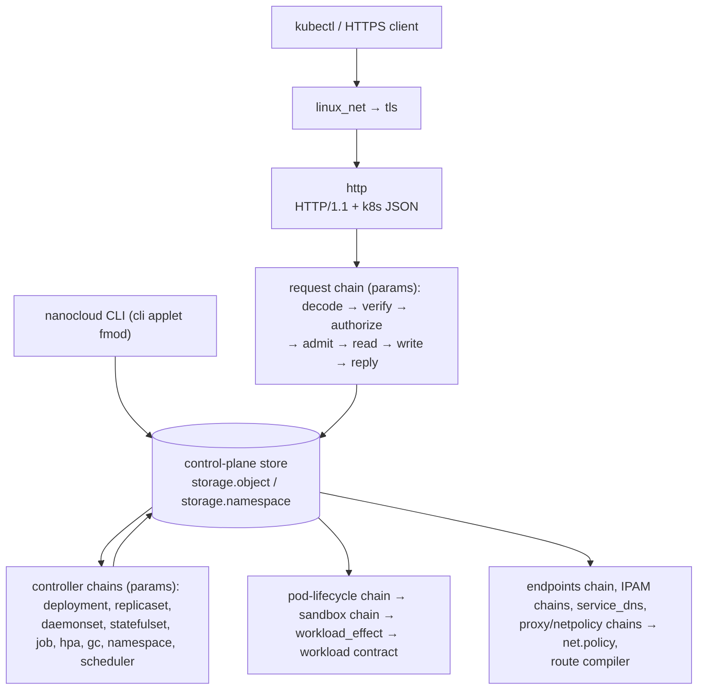

# Nanocloud

Nanocloud is a Kubernetes control plane that runs as a [fluxor](../fluxor/)
graph. The apiserver, every controller and the node's own lifecycle are chains
of generic engines carrying compiled rules. The `no_std` position-independent
modules (`.fmod`) in the tree hold no Kubernetes meaning: every one but the CLI
is a connector, moving bytes across one seam — the store, a socket, an HTTP
route, a container, the packet filter, a volume. There is no host
binary and no separate database: install the package, start one systemd unit,
and the node serves the Kubernetes API.

## Highlights

- **The control plane is a graph.** `fluxor run controlplane.yaml` starts the
  apiserver, the verify → authorize → admit → CRUD request path, and every
  workload controller in a single runtime. Composition is a YAML graph, not a
  process tree.
- **The logic is rules, not code.** A Deployment becoming a ReplicaSet, an
  ownerRef cascade, a scheduler's placement, what `/api/v1` means and what a
  refusal answers: each is a chain of generic Chronicle engines carrying params
  compiled from `modules/app/_chronicle/*.uproc`. No `.fmod` holds what a
  Deployment is, or what a Kubernetes path names.
- **Kubernetes-shaped API.** `kubectl` talks to it directly: core/v1,
  `apps/v1`, `discovery.k8s.io/v1`, `node.k8s.io/v1` and `nanocloud.io/v1`
  discovery documents, list/get/create/update/delete, and `?watch=true`
  watches fenced on the store's own revisions.
- **One store, replicated.** Control-plane state lives in fluxor's
  `storage.object` / `storage.namespace` contracts — versioned keyed bytes with
  compare-and-swap, prefix listing and change subscriptions — served by
  lattice's store as one replica of a group: every write is decided through
  clustor's log (the control-plane nodes are its voters, each worker a
  learner, every peer link mutually authenticated). Each node's graph is its
  replica's only writer, so a watch is a projection of the store's revision stream rather
  than a poll.
- **Host facts stay behind capability surfaces.** A module never calls libc.
  Sockets arrive through `linux_net`/`tls`, containers through the `workload`
  contract, files through `fs`, private keys through the kernel key vault — each
  one a contract admission can gate.
- **Decision and effect are separate.** Controllers compute; the node's backends
  act. Service proxying and NetworkPolicy are rows in the store, applied as a
  `net.policy` table the platform realizes — nftables on Linux, the packet
  filter on bare metal — and whether it is enforced is written down, never
  assumed; the pod-lifecycle chain projects the sandboxes a node should be
  running, and `workload_effect` performs them.
- **Behaviour is proven on real binaries.** There are no unit tests to mock the
  seams: `make test` boots the built `.fmod` artefacts in a fluxor runtime and
  drives them over real HTTP, the real store, and real mTLS.

## Architecture



Every arrow into or out of the store is a contract call, and no stage addresses
another directly — the only direct channels are the net streams at the edge, the
records a chain hands along, and each module's own change sink. A request is
admitted at the edge, written once, and every controller that cares wakes on
the change and writes its own outputs back.
[docs/architecture/modules.md](docs/architecture/modules.md) describes each
chain, the keys it owns, the connectors it reaches them through, and the
capability surfaces behind them.

## Install

The package is built from this checkout against a sibling fluxor tree:

```bash
fluxor update && fluxor sync            # resolve + materialise deps and the SDK
make build                              # build modules/app/* for bcm2712
packaging/debian/build.sh               # stage the .deb
tools/install_deb.sh                    # dpkg -i the newest build, restart the unit
```

The package installs the fluxor CLI and runtime, every nanocloud `.fmod`, the
control-plane and worker graph templates (`/etc/nanocloud.io/fluxor/`), the
node and image-plane graphs, and a systemd unit that renders this node's graph
(`nanocloud-graph.sh`, from `/etc/nanocloud.io/cluster.env` and the peer keys
in `/etc/nanocloud.io/pki`, both provisioned on install) and runs it in
`/var/lib/nanocloud.io/control-plane/store`. A fresh install is a cluster of
one: the control plane, replica 0, alone.
`/usr/bin/nanocloud` is a busybox-style symlink to `fluxor`, so `nanocloud <cmd>`
dispatches the `nanocloud_cli` applet.

## A cluster

A worker joins the control plane's store as a learner. On the worker, set
`NANOCLOUD_ROLE=node`, its `NANOCLOUD_REPLICA_ID` and `NANOCLOUD_PEERS`
(every replica's address) in `/etc/nanocloud.io/cluster.env`, and give it
each replica's certificate as `/etc/nanocloud.io/pki/peers/<id>.pem`; give
every control-plane node the worker's (`nanocloud-cluster pin` prints a
node's). Then, on a control-plane node:

```bash
sudo nanocloud-cluster add-node 1       # replica 1 joins, by the operator key
```

The worker registers itself in `/nodes/`, renews its lease, and is scheduled
onto once ready.

## Using it

```bash
sudo systemctl start nanocloud          # run the control-plane graph

nanocloud status                        # cluster object counts
nanocloud get pods                      # list object names under a resource
nanocloud get pods default/web-0        # show one object's stored fields
nanocloud describe pods default/web-0   # a labelled read of one object
nanocloud apply deployments default/web '{"spec":{"replicas":3, ...}}'
nanocloud scale deployments default/web 5
nanocloud delete pods default/web-0
nanocloud rollout status default/web    # progress against the current template
nanocloud rollout undo default/web      # restore the archived previous template
nanocloud watch pods                    # stream a listing as it changes
nanocloud logs -f <sandbox>             # a sandbox's stdout/stderr
nanocloud exec -it <sandbox> -- sh      # a command inside a sandbox
nanocloud diagnostics                   # counts across every resource + health
nanocloud policy                        # NetworkPolicies + enforcement status
nanocloud volume                        # PVCs and the volumes bound to them
nanocloud bundle export > cluster.txt   # every object as `<key>\t<json>` lines
nanocloud bundle apply < cluster.txt    # recreate them from that dump
nanocloud token default-sa default      # mint a ServiceAccount JWT
nanocloud ca                            # print the cluster CA certificate
```

The CLI drives the store directly through the storage contracts, so it works
without the HTTP edge. `kubectl` reaches the same objects over the API, served
on :7443:

```bash
kubectl --server https://127.0.0.1:7443 get pods -A --watch
```

## The API surface

| Group | Resources |
| ----- | --------- |
| core/v1 | pods (+ `pods/log`, `pods/exec`), services, endpoints, configmaps, secrets, events, persistentvolumeclaims |
| apps/v1 | deployments, replicasets, statefulsets, daemonsets |
| discovery.k8s.io/v1 | endpointslices |
| node.k8s.io/v1 | runtimeclasses |
| nanocloud.io/v1 | bundles, roles, rolebindings, volumesnapshots, certificates |

The request path is a Chronicle chain: wave's `http` terminates HTTP/1.1 behind
`tls` and hands each request, as an exchange, to `http_chain`, which gives the
chain one request envelope for it and turns the chain's replies into its
response; a Chronicle decode program (`kube.rd`) projects the envelope into a
record, and every decision after that — which resource a path names, whether the credential is good enough,
what a refusal answers, which store operation the verb implies — is params
compiled from `modules/app/_chronicle/apiplane.uproc`. Authorization is one
store probe of a grant index that the RBAC chains keep true from the real
Role/ClusterRole/RoleBinding/ClusterRoleBinding objects. Admission is params
too: a policy read and a live-object COUNT through `store_effect`, then a
decision. No node on the path holds Kubernetes meaning in compiled code.

Discovery documents (`/api`, `/apis`, `/api/v1`, `/apis/<group>/<version>`),
`/version` and `/openapi/` are literals in a decision — the API surface is data.
Namespaced paths (`/apis/<group>/<v>/namespaces/<ns>/<resource>[/<name>]`) and
cluster-scoped paths resolve through the same rules; a grouped resource is keyed
group-qualified (`deployments.apps`) so it never collides with a same-named
resource in another group. `?watch=true` is served by a second chain driven by
store changes, writing into the same reply stage.

## Security

- **TLS at the edge.** The `tls` module terminates TLS 1.3 in front of the
  HTTP front. With a peer-auth profile it verifies the client certificate
  against the cluster CA and emits a per-session SPIFFE-style peer identity,
  which reaches the request chain as a field on the decoded record — so a
  certificate that does not chain never opens a connection, and one that does
  is authorized by its SVID.
- **Two roots, nothing else provisioned.** A node holds one symmetric key —
  `FLUXOR_SEAL_KEY`, generated once at install — and one signing key,
  `nanocloud.ca`, generated *inside* the fluxor key vault on first use and only
  ever stored sealed under the first. Every certificate and every
  ServiceAccount token is signed under that one vault key, by kagi; no private
  key is issued, exported or written to the store.
- **Signed bearer tokens.** ServiceAccount tokens are Chronicle params over
  kagi's `token_mint` (through the `kagi_mint` connector): ES256 JWS with the
  `kubernetes.io` claim and a one-hour `iat`/`exp`. Verification is kagi's own,
  through `kagi_verify`. No credential is ever stored: a token is admitted
  because its signature verifies, not because a record exists.
- **Deny-by-default authorization.** Kubernetes RBAC objects are expanded into a
  grant index (`rbac_*.uproc`); a request is admitted only when a grant covers
  its namespace, verb and resource, and a deleted binding's grants are pruned.
- **Admission before the store.** Every mutating request crosses the
  admission decisions (`admission.uproc`), which validate required fields,
  apply defaults and enforce per-resource quota against live counts.
- **Device certificates.** A Device names the public key it holds; the
  `dv_` chain has kagi's `certificate_endpoint` certify it (through the generic
  `http_effect` connector) with its SPIFFE id in the SAN, and writes back the
  leaf and the CA it chains to.

## Development

```bash
make build     # fluxor build   — compile modules/app/* to .fmod
make test      # fluxor test    — run scripts/*-e2e.sh against the built modules
make lint      # fluxor lint    — the source-tree hygiene suite
make ci        # fluxor ci      — lint + strict build + the full E2E gate
make publish   # fluxor publish
```

Each lifecycle target delegates to its `fluxor` verb, which reads this
project's shape from `fluxor.toml`. There is no cargo crate: the modules are
`no_std` PIC sources that compile against the SDK `fluxor sync` materialises
under `target/fluxor/fluxor-abi/sdk/`. `make lint` is therefore the source-tree
hygiene suite, which needs no build; formatting and clippy compile the PIC
sources per target, so they run as `make ci` phases.

The hygiene scanner enforces two rules that matter here: every `#[allow]`
carries a `reason`, and inline `#[cfg(test)]` blocks are forbidden under
`modules/` — in a `no_std` PIC module they compile away silently, so a green
run would prove nothing. Behaviour is proven by the graph E2Es in `scripts/`,
each of which boots a real runtime with the real `.fmod` artefacts and asserts
on the store and the wire.

```
fluxor.toml / fluxor.lock       project shape and registry-pinned dependencies
modules/app/<name>/             one module: mod.rs + manifest.toml
modules/app/_shared/            include-only helpers (JSON, store ops, fields)
modules/app/_chronicle/         controller rules compiled to Chronicle params
packaging/debian/               the graphs and bundle sources the .deb ships
scripts/*-e2e.sh                live graph E2Es — the behaviour gate
```

## Contributing

Issues and pull requests are welcome. A change lands with the graph E2E that
proves it: add or extend a `scripts/*-e2e.sh` that boots the real artefacts.
Keep decisions in rules and effects behind capability surfaces — if a change
wants a new host fact, it wants a contract, not a syscall; and if it wants a new
`.fmod`, it should first be sure a rule cannot say it.
